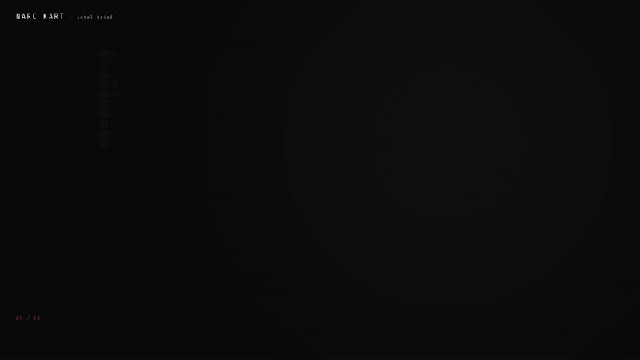
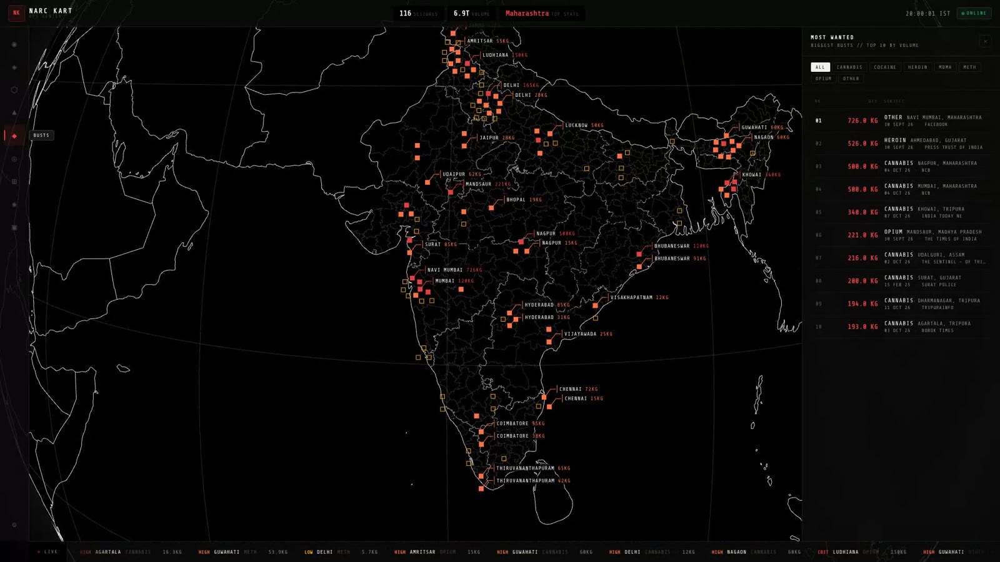
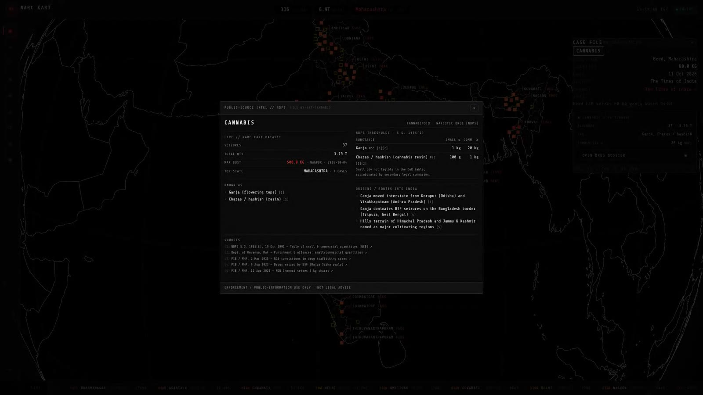

<div align="center">

# NARC KART

**India's drug seizure tracker, built as a tactical ops-center dashboard.**

[**Live site → narc-kart.vercel.app**](https://narc-kart.vercel.app) · [Watch the intel brief with sound (36s)](docs/media/narc-kart-intel-brief.mp4)

[](docs/media/narc-kart-intel-brief.mp4)


</div>

---

## What it is

NARC KART puts publicly reported drug seizures in India on a 3D globe. Every bust
that makes the news (who seized what, how much, where and when) becomes a marker
you can click. Around the globe sit panels that break the data down by state,
drug, agency and time.

The data comes from news headlines. A GitHub Action reads Google News every
Sunday, keeps only the stories that name a drug, a quantity and a known Indian
city, and merges them into one JSON file. The site is fully static, so there is
no server or database and nothing to pay for.

It is a portfolio piece as much as a tool. The "classified ops center" look is
deliberate (see [PRODUCT.md](PRODUCT.md) and [DESIGN.md](DESIGN.md)), but the
records are real reports about real crimes.

---

## Features

| | Panel | What you get |
|---|---|---|
| ◉ | **Radar** | A draggable wireframe globe with India's state and district borders. Each seizure is a marker coloured by severity (LOW under 10 kg, HIGH 10 to 100 kg, CRIT over 100 kg), and the biggest busts get callout labels. |
| 📁 | **Case file** | Click any marker, callout or ticker item and the camera flies to that city and opens a case file with location, quantity, drug, agency, date, the source link and the original headline. |
| ▤ | **Drug dossier** | From a case file (or the filter chips), open a dossier on that drug: live stats from the dataset, street names, small and commercial quantity limits under the NDPS Act, and how it enters India, each with a cited source. |
| ◈ | **Intel** | The briefing: total seizures, total volume, critical cases, the drug-type mix and the top states. |
| ⬡ | **Network** | How many agencies and states are involved, with states and agencies ranked side by side. |
| ◆ | **Busts** | "Most wanted": the ten biggest busts, filterable by drug. Click a row to fly to it. |
| ▲ | **Trending** | The highest-volume seizures and the most recent ones. |
| ◎ | **Agency** | Every agency (NCB, state police and others) ranked by seized volume. |
| ⊞ | **Compare** | Volume by state against counts by drug type. |
| ✺ | **Festival** | A separate dataset of rave, concert and festival busts, with its own pink and cyan globe mode, drug profile and incident list. |
| ▣ | **Terminal** | A command line over the data: `stats`, `top 5`, `find heroin`, `states`, `agencies`, `recent 10`. |
| ⚙ | **Filters** | Narrow everything by time period, drug type, state and weight range. The globe and every panel update together. |

The header always shows total seizures, total volume and the top state, and a live
ticker of the latest busts runs along the bottom.

### Most wanted

The ten biggest busts, ranked next to the globe. Click a row and the camera flies to it.



### Drug dossier

Live stats, street names, NDPS quantity limits and trafficking routes for each drug, every claim with a source.



---

## How the data gets in

```
Google News RSS ──▶ scripts/update_data.py ──▶ frontend/public/data.json ──▶ Vercel redeploy
   (Sundays, 18:00 IST, GitHub Action)        (merge only, never deletes)
```

- [`scrape-weekly.yml`](.github/workflows/scrape-weekly.yml) runs `update_data.py`
  every Sunday. It uses only the standard library, so there is nothing to install.
- A headline is kept only if it names a drug, a quantity and a city listed in
  [`scripts/data/cities.json`](scripts/data/cities.json), which also provides the
  state and coordinates.
- New records are merged in, and the script refuses to shrink the file. If anything
  changed, the Action commits and Vercel redeploys.
- [`ci.yml`](.github/workflows/ci.yml) builds the frontend and validates every
  record in `data.json` on each push and PR.

```bash
python scripts/update_data.py --dry-run   # show what would be added
python scripts/update_data.py             # update data.json locally
```

The festival dataset (`frontend/public/data_raves.json`) is built separately with
`scripts/build_raves_json.py`.

---

## Run it locally

```bash
git clone https://github.com/AayushBhat07/narc-kart.git
cd narc-kart/frontend
npm install
npm run dev        # http://localhost:5173
```

Run `npm run build` to produce a production build. The output in `frontend/dist/`
is plain static files that any static host can serve. The root `vercel.json` already
points Vercel at it.

---

## Tech stack

| Layer | Choice |
|---|---|
| UI | React 19, TypeScript, CSS Modules, Framer Motion |
| Globe | globe.gl + three.js, world-atlas and India district TopoJSON |
| Charts | MUI X Charts |
| Build | Vite 6 |
| Data | Python 3 (stdlib) in a weekly GitHub Action |
| Hosting | Vercel, static |

## Project structure

```
narc-kart/
├── frontend/
│   ├── public/
│   │   ├── data.json                 all seizure records + precomputed stats
│   │   ├── data_raves.json           festival / rave dataset
│   │   └── india-districts.topojson  borders for the globe
│   └── src/
│       ├── App.tsx                   HUD, icon rail, ticker, panel routing
│       ├── components/               SeizureGlobe, panels, case file, filters
│       ├── data/drugIntel.ts         drug dossiers with cited sources
│       └── hooks/useApi.ts           loads data.json, client-side filtering
├── scripts/
│   ├── update_data.py                weekly news → data.json updater
│   └── data/cities.json              city → state + coordinates
├── docs/media/                       intel brief video and screenshots
├── video/                            Remotion project for recording demo videos
└── .github/workflows/                ci.yml, scrape-weekly.yml
```

---

## Author

**Aayush Bhat**: [LinkedIn](https://linkedin.com/in/aayush-bhat07/) · [GitHub](https://github.com/AayushBhat07) · [Portfolio](https://aayushbhat.vercel.app)

## License

MIT. The records describe real crimes reported in the press. Treat them with care,
and check the linked source before relying on any single record.
